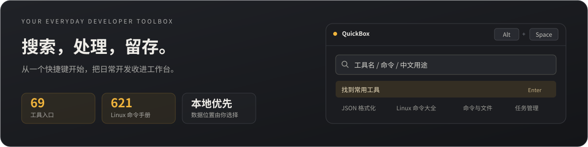
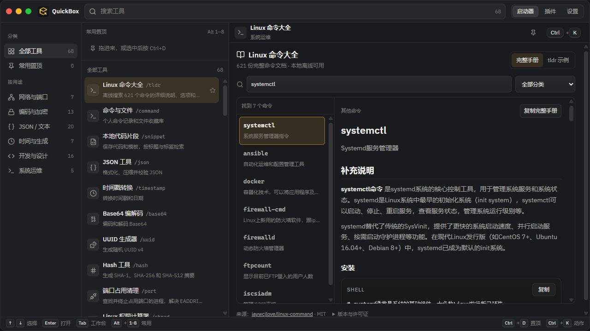
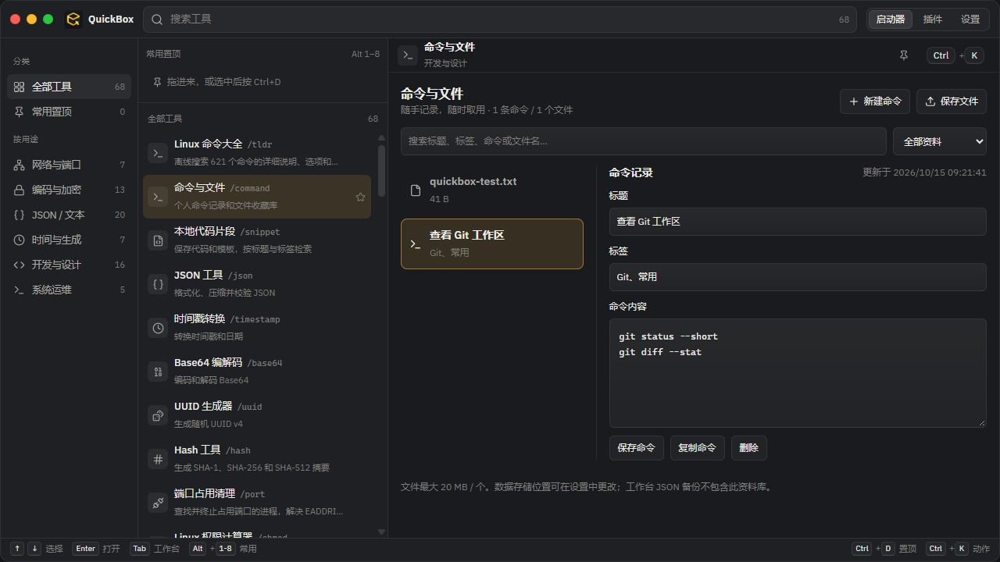

<div align="center">


# QuickBox

**让工具、命令和文件，随叫随到。**

键盘优先的桌面开发工具箱，把日常处理、命令查阅与个人资料收在一个工作台里。

[](https://github.com/CrescentR/Quick-Box/actions/workflows/check.yml)
[](https://github.com/CrescentR/Quick-Box/actions/workflows/release.yml)


[**下载安装**](https://github.com/CrescentR/Quick-Box/releases) · [产品亮点](#features) · [界面预览](#screenshots) · [上手使用](#getting-started) · [开发指南](docs/development.md)

</div>



QuickBox 面向经常处理 JSON、排查端口、查找命令、整理代码与文件的开发者。按下全局快捷键，输入工具名称或用途，就能在同一个窗口中完成操作。常用工具可以置顶，命令和文件可以留存在本机，下次需要时直接取用。

<a id="features"></a>

## 一个入口，覆盖日常开发

| 你正在做的事 | QuickBox 如何帮忙 |
| --- | --- |
| **处理一段数据** | 格式化 JSON / YAML / XML / SQL，转换编码、清洗文本、比较差异，支持部分工具之间传递结果。 |
| **回忆一个命令** | 离线检索 **621 份 Linux 命令手册**，查说明、参数和示例，或切到 tldr 快速示例。 |
| **排查本机问题** | 查看端口占用、清理占用进程、搜索文件内容、校验文件摘要、预演批量重命名。 |
| **留住常用资料** | 记录多行命令、保存代码片段和文件副本，按标题、标签或内容查找。 |
| **管理零散备份** | 在设置中保存 ZIP、SQL、图片、文档等任意格式文件，保留独立副本并随时导出。 |
| **保持操作顺手** | 中英文搜索、使用记录排序、最多 8 个常用置顶、全局热键、托盘、浅色 / 暗色 / 跟随系统主题。 |

目前内置 **20 个插件、68 个工具入口**。插件页支持搜索与启停；命令手册和工具视图按需加载。

<a id="screenshots"></a>

## 界面预览

**左侧找到工具，右侧直接处理。** Linux 命令大全支持正文搜索、分类筛选和完整 Markdown 阅读。



<details>
<summary><strong>查看命令与文件工作台</strong></summary>

保存多行命令、添加标签、检索和复制内容，也可以收藏文件的独立副本。



</details>

<a id="download"></a>

## 下载与安装

前往 [GitHub Releases](https://github.com/CrescentR/Quick-Box/releases) 选择安装包。标有 **Pre-release** 的版本由日常代码推送自动构建；正式版本使用 `vX.Y.Z` 标签发布。

| 平台 | 安装包 | 使用说明 |
| --- | --- | --- |
| **Windows x64** | `*_windows_x64_setup.exe` / `*_windows_x64.msi` | 优先使用 `.exe` 安装器；需要 MSI 时选择 `.msi`。 |
| **Linux x64** | `*_linux_x64.AppImage` / `*_linux_x64.deb` | 自动构建已启用；AppImage 建议放在用户可写目录，数据目录要求见 [使用指南](docs/usage.md#linux-notes)。 |
| **macOS** | 暂无自动发布包 | 仓库保留本地构建脚本，当前不提供 macOS Release 安装包。 |

> [!IMPORTANT]
> **可安装到 C 盘或其他磁盘，由用户选择。** 默认数据保存在所选安装目录下的 `data` 文件夹，不另行默认写入 AppData。请选择当前用户可写的安装目录和数据目录，例如 `C:\Apps\QuickBox` 或 `D:\Apps\QuickBox`。

Windows 界面依赖系统 WebView2。安装器会处理 WebView2 运行时检测；首次安装可能需要联网下载缺失的运行时。Release 中的 `SHA256SUMS.txt` 可用于核对安装包。

<a id="getting-started"></a>

## 从第一次呼出开始

1. **打开工作台**：启动 QuickBox，默认使用 `Alt + Space` 呼出或隐藏窗口；热键可以在设置中修改。
2. **找到工具**：输入 `json`、`端口`、`Linux`，或在左侧选择分类，点击结果或按 `Enter` 打开。
3. **留下常用入口**：选中工具后按 `Ctrl + D` 置顶，之后使用 `Alt + 1–8` 直接打开。
4. **保存自己的内容**：搜索“命令与文件”或“本地代码片段”；任意格式文件备份在“设置 → 统一备份管理”中添加。

| 快捷键 | 操作 |
| --- | --- |
| `Alt + Space` | 全局呼出 / 隐藏，可在设置中修改 |
| `↑` / `↓`、`Enter` | 在启动器中选择、打开工具 |
| `Ctrl + D`、`Alt + 1–8` | 置顶当前工具、打开对应常用工具 |
| `Ctrl + K` | 打开启动器动作面板 |
| `Ctrl + ,` | 打开设置 |
| `Ctrl + 1` / `2` / `3` | 切换启动器 / 插件 / 设置 |

快捷键按当前页面和输入焦点生效；工具编辑与分类导航等完整说明见 [使用指南](docs/usage.md)。

<a id="tools"></a>

## 工具一览

工具按用途组织，下面列出常用入口；完整列表可在应用内搜索。

| 分类 | 代表工具 |
| --- | --- |
| **网络与端口** | 端口占用清理、CIDR 子网计算、Cookie 解析、URL 编解码、Query 参数构建、HTTP 状态码速查、cURL ↔ fetch |
| **编码与加密** | Base64、Unicode、HTML Entity、Hash、HMAC、AES-GCM、JWT 密钥生成 / 解析 / 生成、文件哈希、二维码 |
| **JSON / 文本** | JSON / YAML / XML / SQL 格式化、文本差异、正则测试 / 替换 / 模板库、CSV ↔ JSON、YAML ↔ Properties、Markdown 预览与表格 |
| **时间与生成** | 时间戳、日期差值、时区、UUID、随机字符串、Cron、占位文本 |
| **开发与设计** | 命令与文件、代码片段、JSON → TypeScript / Rust / Schema、Git Commit、Gitignore、SemVer、颜色转换、屏幕取色、单位换算 |
| **系统运维** | Linux 命令大全、chmod 权限计算、文件内容搜索、批量重命名、剪贴板纯文本历史 |

### 随应用带走的 Linux 命令手册

完整内置 [jaywcjlove/linux-command](https://github.com/jaywcjlove/linux-command) 当前快照的 **621 份文档**，包括上游生成索引尚未列出的文档。支持命令名、中文用途、参数和示例全文搜索，完整呈现说明、代码块与表格，也保留 tldr 快速示例。

文档版本为 `1.22.0`，固定提交与内容校验信息保存在 [来源清单](src/builtin-plugins/command-cheatsheet-tool/data/source.json)。日常查阅不依赖在线文档站点。

<a id="data"></a>

## 内容留在本机，位置由你选择

配置、插件启停、使用记录、命令和代码片段保存在 SQLite；文件与备份以独立副本保存在数据目录。当前不提供账号和云同步，核心工具在本地处理内容；检查更新、打开发行页及文档外链等操作需要网络。

| 保存入口 | 适合存什么 | 规则 |
| --- | --- | --- |
| **命令与文件** | 多行命令、脚本说明、标签、经常取用的文件 | 支持搜索、编辑、复制与导出；其中的文件单个最大 **20 MB**。 |
| **本地代码片段** | 常用代码、模板 | 可标记语言，按标题、标签和正文检索。 |
| **统一备份管理** | ZIP、SQL、图片、文档等任意格式文件 | 原样复制，不解析内容，无 20 MB 限制；同名文件分别保留。 |

默认目录示例：

```text
D:\Apps\QuickBox\
├── quickbox.exe
├── storage-location.json     # 自定义位置配置，迁移后保存在安装目录
└── data\
    ├── quickbox.sqlite3      # 配置、命令、片段、使用记录等
    ├── saved-files\          # “命令与文件”收藏的文件副本
    ├── backups\              # 设置中的统一文件备份
    └── webview\              # 界面缓存与浏览器本地状态
```

在“设置 → 数据存储位置”点击 **选择文件夹**，选取自己需要的可写空目录，再点击 **迁移并使用**。数据库、收藏文件和备份会一起复制，原目录保留副本；重启后 WebView 缓存也会使用新位置。

统一备份管理用于保管用户文件的副本。需要备份整个 QuickBox 时，退出应用后复制当前完整数据目录，并保留安装目录中的位置配置。迁移恢复、剪贴板行为和常见问题见 [数据管理说明](docs/usage.md#data-management)。

<a id="development"></a>

## 参与开发

项目采用 **Tauri 2 + React 18 + TypeScript + Rust + SQLite**，由 Vite 提供前端开发与构建，Zustand 管理状态，pnpm 管理前端依赖。React 负责界面和工具交互，Rust 负责窗口、快捷键、文件和持久化等系统能力。

### 启动项目

准备 **Node.js 24、pnpm 9.15.4、Rust stable** 和平台依赖，详见 [开发环境配置](docs/development.md)。Windows 需要 MSVC C++ 构建工具与 WebView2，代码仓库应放在当前用户可写的目录，磁盘由你选择。

```bash
git clone https://github.com/CrescentR/Quick-Box.git
cd Quick-Box
pnpm install --frozen-lockfile
pnpm tauri:dev
```

只调整界面时可以运行 `pnpm dev`，在 `http://127.0.0.1:1420` 预览。全局快捷键、原生文件夹选择、磁盘备份和进程管理等系统能力需要桌面环境。

| 开发任务 | 命令 |
| --- | --- |
| 启动桌面开发 | `pnpm tauri:dev` |
| 浏览器预览 | `pnpm dev` |
| 复用已运行的 Vite，启动桌面壳 | `pnpm tauri:dev:attach` |
| 前端类型、测试、构建与 Rust 检查 | `pnpm verify` |
| Rust 单元测试 | `cargo test --locked --manifest-path src-tauri/Cargo.toml --lib` |
| 打包 Windows / Linux | `pnpm tauri:build:win` / `pnpm tauri:build:linux` |
| 同步完整 Linux 命令文档 | `pnpm sync:linux-commands` |

`pnpm verify` 包含 Rust `cargo check`；提交前另外运行上面的 Rust 单测命令。双终端开发、脚本全表、存储约定与故障排查见 [开发指南](docs/development.md)。

### 自动构建与发布

- **Pull Request**：运行 Check 工作流，验证类型、前端测试、前端构建与 Rust 单测。
- **推送 `main/master`**：通过验证与两个平台的构建后，自动发布带提交标识的预览版。
- **推送 `vX.Y.Z` 标签**：校验应用版本一致后，自动发布正式版。

安装包先按平台构建并汇总，全部成功后才公开 Release，同时生成 SHA256 校验文件。首次 Rust 优化编译和 Linux 打包可能需要数分钟；可以在 Actions 中展开构建步骤查看进度。完整发布流程见 [发布指南](docs/release.md)。

<a id="docs"></a>

## 文档导航

完整目录见 [文档中心](docs/README.md)。

| 你想了解的内容 | 从这里开始 |
| --- | --- |
| 安装、快捷键、工具使用与数据备份 | [使用指南](docs/usage.md) |
| 环境准备、日常开发、验证与排查 | [开发指南](docs/development.md) |
| 添加工具、注册命令和视图 | [插件开发示例](docs/插件示范.md) |
| 打包、自动预览版与正式发布 | [发布指南](docs/release.md) |
| 前端与 Rust 的职责划分 | [架构概览](ARCHITECTURE.md) |
| 组件、主题与视图规范 | [核心组件规范](docs/核心组件规范.md) · [插件视图规则](docs/React渲染插件View规则.md) |

<details>
<summary>项目目录与设计资料</summary>

```text
Quick-Box/
├── src/
│   ├── pages/              # 启动器、插件管理、设置
│   ├── builtin-plugins/    # 内置工具与命令文档
│   ├── core/               # 命令、插件、工具上下文与工作台模型
│   ├── api/                # 前端系统能力调用
│   ├── stores/             # 状态与持久化交互
│   └── ui/                 # 通用界面组件
├── src-tauri/
│   ├── src/commands/       # Rust 系统命令
│   ├── src/storage/        # 数据库、存储位置与迁移
│   └── src/platform/       # 平台差异实现
├── tests/                  # 前端逻辑与交互测试
├── scripts/                # 启动、构建辅助与命令文档同步
├── docs/                   # 使用、开发、发布与设计文档
└── .github/workflows/      # 验证与 Release 自动化
```

历史设计与规划可参考 [架构设计](docs/Architecture.md)、[UI 设计稿](docs/quickbox_ui_design_system.md)、[项目发展规划](docs/项目发展规划.md) 和 [插件市场方案](docs/插件市场需求与技术方案.md)。规划文档不代表当前版本已交付的功能；当前加载器只注册仓库内置插件。

</details>

<a id="credits"></a>

## 致谢与许可

QuickBox 基于 Tauri、React、Vite、Zustand、SQLite 等开源项目构建，感谢这些项目及贡献者。

| 内置内容 | 来源与许可 |
| --- | --- |
| Linux 命令大全 | [jaywcjlove/linux-command](https://github.com/jaywcjlove/linux-command) · [MIT 许可原文](src/builtin-plugins/command-cheatsheet-tool/data/LICENSE.linux-command.txt)，保留作者署名 |
| tldr 快速示例 | [tldr-pages/tldr](https://github.com/tldr-pages/tldr) · CC BY 4.0，整理自上游示例 |
| IBM Plex Sans 字体 | [本地许可文件](src/assets/fonts/IBM-Plex-Sans-LICENSE.txt) |

仓库目前未附项目级 `LICENSE` 文件；第三方依赖与内置内容遵循各自许可证。`package.json` 的 `private: true` 用于防止意外发布到 npm，不代表一份开源许可证。

<div align="center">

[下载 QuickBox](https://github.com/CrescentR/Quick-Box/releases) · [反馈问题](https://github.com/CrescentR/Quick-Box/issues) · [查看构建](https://github.com/CrescentR/Quick-Box/actions)

</div>
