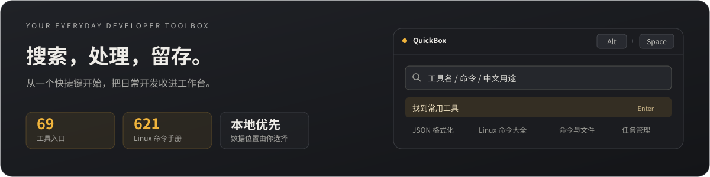
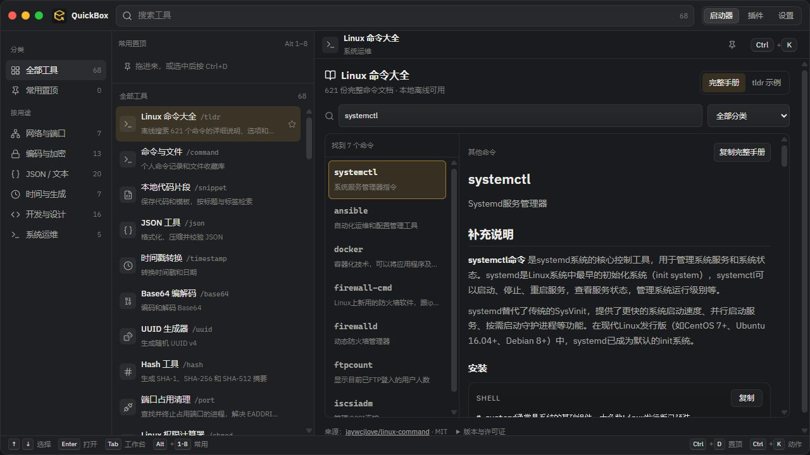
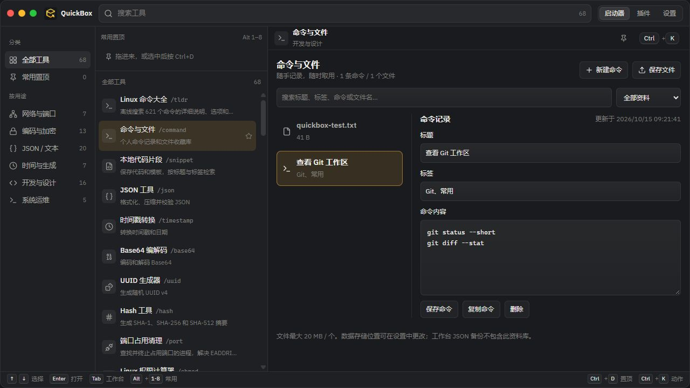

<div align="center">


# QuickBox

**Tools, commands, tasks, and files — ready at a keystroke.**

A keyboard-first desktop developer toolbox that brings everyday utilities, task management, offline command docs, and personal snippets/files together in one fast workspace.

**English** · [简体中文](README.zh-CN.md)

[](https://github.com/CrescentR/Quick-Box/actions/workflows/check.yml)
[](https://github.com/CrescentR/Quick-Box/actions/workflows/release.yml)


[**Download**](https://github.com/CrescentR/Quick-Box/releases) · [Features](#features) · [Screenshots](#screenshots) · [Getting Started](#getting-started) · [Development Guide](docs/development.md)

</div>



QuickBox is built for developers who constantly inspect JSON, track down open ports, look up shell commands, and organize code or files. Press the global shortcut, type a tool name or keyword, and finish the job in a single window. Pin your favorites, keep reusable commands and files locally, and switch seamlessly between English and Simplified Chinese.

<a id="features"></a>

## One Workspace for Everyday Dev Work

| What you are doing | How QuickBox helps |
| --- | --- |
| **Transform data** | Format JSON / YAML / XML / SQL, convert encodings, clean whitespace, and compare diffs with result handoff across compatible tools. |
| **Recall a CLI flag** | Search **621 Linux command manuals** completely offline for descriptions, options, examples, or switch to tldr quick examples. |
| **Debug your machine** | Inspect listening ports and kill processes, search local file contents, verify file checksums, and preview batch file renames. |
| **Keep reusable notes** | Save multi-line commands, code snippets, and local file copies, searchable by title, tag, or content. |
| **Plan upcoming work** | Create tasks with natural date input, organize lists, tags, priorities, subtasks, recurring rules, and due reminders. |
| **Store ad-hoc backups** | Back up arbitrary ZIP, SQL, image, or document files as independent copies in Settings and export them anytime. |
| **Stay in flow** | Bilingual search (English & Chinese), usage-based ranking, up to 8 pinned tools, global hotkey, tray controls, and Light / Dark / System themes + English / Simplified Chinese / System UI language. |

QuickBox currently ships with **21 built-in plugins and 73 tool commands**. Manage and filter plugins on the Plugins page; command manuals and tool views load on demand.

<a id="screenshots"></a>

## Screenshots

**Find a tool on the left, work directly on the right.** The Linux Command Reference supports full-text search, category filtering, and complete Markdown rendering.



<details>
<summary><strong>Explore Commands & Files Workspace</strong></summary>

Save multi-line commands, add tags, search and copy snippets, or attach independent file copies.



</details>

<a id="download"></a>

## Download & Install

Grab installers from [GitHub Releases](https://github.com/CrescentR/Quick-Box/releases). Builds tagged as **Pre-release** are generated automatically from branch pushes; stable releases use `vX.Y.Z` tags.

| Platform | Installer | Notes |
| --- | --- | --- |
| **Windows x64** | `*_windows_x64_setup.exe` / `*_windows_x64.msi` | `.exe` installer recommended; `.msi` available for enterprise deployment. |
| **Linux x64** | `*_linux_x64.AppImage` / `*_linux_x64.deb` | Automated builds enabled; run AppImage from a user-writable directory. See [Usage Guide](docs/usage.md#linux-notes). |
| **macOS** | No prebuilt release yet | Local build scripts are included in the repo, but macOS releases are not currently published. |

> [!IMPORTANT]
> **Choose your own install drive (C: or any drive).** By default, QuickBox stores data inside a `data` directory next to the executable rather than forcing AppData. Pick a user-writable install directory and data directory, such as `C:\Apps\QuickBox` or `D:\Apps\QuickBox`.

On Windows, QuickBox uses the system WebView2 runtime. The installer detects WebView2 and may download it online on first install if missing. Use `SHA256SUMS.txt` in each release to verify installer integrity.

<a id="getting-started"></a>

## Getting Started

1. **Summon the launcher**: Launch QuickBox and press `Alt + Space` to toggle the window (customizable in Settings).
2. **Search or browse**: Type `json`, `port`, `linux`, or pick a category on the left, then click or press `Enter` to open.
3. **Pin frequent tools**: Select a tool and press `Ctrl + D` to pin it, then open pinned tools directly with `Alt + 1–8`.
4. **Save personal content**: Open *Commands & Files* or *Local Code Snippets*; add arbitrary file backups via *Settings → Unified Backup Management*.
5. **Track tasks**: Open *Task Manager* (or search `todo`) to capture tasks. Existing Task users can import via JSON—see the [Task Management Guide](docs/task-management.md).
6. **Switch language**: Change *Interface Language* (`System`, `English`, `简体中文`) in *Settings*, or press `Ctrl + K` in the launcher for a quick toggle.

| Shortcut | Action |
| --- | --- |
| `Alt + Space` | Global toggle (customizable in Settings) |
| `↑` / `↓`, `Enter` | Navigate and open tools in Launcher |
| `Ctrl + D`, `Alt + 1–8` | Pin/unpin tool, open pinned tool 1–8 |
| `Ctrl + K` | Open Launcher Action Panel |
| `Ctrl + ,` | Open Settings |
| `Ctrl + 1` / `2` / `3` | Switch between Launcher / Plugins / Settings |

Shortcuts respect active page and input focus; see the [Usage Guide](docs/usage.md) for full keyboard details.

<a id="tools"></a>

## Built-in Tools Overview

Tools are grouped by everyday workflow; search the complete catalog inside the app.

| Category | Representative Tools |
| --- | --- |
| **Network & Ports** | Port Killer, CIDR Subnet Calculator, Cookie Inspector, URL Encoder/Decoder, URL Query Builder, HTTP Status Codes, cURL ↔ fetch Converter |
| **Encoding & Crypto** | Base64, Unicode Escape, HTML Entity, Hash, HMAC, AES-GCM, JWT Key Generator / Decoder / Generator, File Hash Checksum, QR Code Studio |
| **JSON & Text** | JSON / YAML / XML / SQL Formatters, Text / Code Diff, Regex Tester / Replace / Library, CSV ↔ JSON, YAML ↔ Properties, Markdown Preview & Table |
| **Time & Generators** | Timestamp Converter, Date Difference, Time Zone Converter, UUID Generator, Random String Generator, Cron Expression Helper, Placeholder Text |
| **Dev & Design** | Task Manager, Commands & Files, Code Snippets, JSON → TypeScript / Rust / Schema, Conventional Git Commit, `.gitignore` Builder, SemVer Helper, Color Converter, Screen Color Picker, Unit Converter |
| **System & Ops** | Linux Command Reference, chmod Calculator, File Content Search, Batch Rename Preview, Clipboard Plain Text History |

### Offline Linux Command Reference

Ships with **621 Markdown manuals** from a pinned snapshot of [jaywcjlove/linux-command](https://github.com/jaywcjlove/linux-command), including entries not yet listed in upstream's generated index. Search across command names, descriptions, flags, and examples, view full Markdown tables and code blocks, or switch to tldr concise examples.

Pinned upstream version `1.22.0` and checksum provenance live in [source.json](src/builtin-plugins/command-cheatsheet-tool/data/source.json). Completely usable offline.

### Built-in Task Manager

Task management adapts core capabilities from [CrescentR/Task](https://github.com/CrescentR/Task): Today & Overdue, Inbox, Upcoming 30 Days, Completed, and Trash views; custom lists, tags, subtasks, P1–P4 priorities, pinning, recurring tasks, and the 12 most recent task templates.

Type natural date/time expressions (such as tomorrow at 3 PM or Chinese expressions like `明天下午三点开会`) or configure exact due dates and times. Due reminders require both date and time and check every 15 seconds while QuickBox is running (including in tray). JSON import/export preserves core task fields; CSV and Markdown support lightweight interchange. See the [Task Management Guide](docs/task-management.md).

<a id="data"></a>

## Local-First Storage

Settings, plugin toggles, usage history, tasks, commands, and snippets are stored in local SQLite; saved files and backups live as standalone copies inside your data directory. QuickBox has no user accounts or cloud sync—core tools process everything locally (network access is only used for update checks, external release links, and docs links).

| Store | Intended Content | Rules |
| --- | --- | --- |
| **Task Manager** | Todos, schedules, recurring tasks, tags, subtasks | JSON import/export preserves core fields; back up the whole data directory for a full snapshot. |
| **Commands & Files** | Multi-line commands, script notes, tags, quick-access files | Search, edit, copy, and export; attached files capped at **20 MB** each. |
| **Local Snippets** | Reusable code snippets and templates | Tag language and search by title, tags, or body. |
| **Unified Backups** | Arbitrary ZIP, SQL, image, and document files | Raw copy without parsing and no 20 MB cap; duplicate names kept separately. |

Example portable directory layout:

```text
D:\Apps\QuickBox\
├── quickbox.exe
├── storage-location.json     # Custom storage path config created after migration
└── data\
    ├── quickbox.sqlite3      # Settings, tasks, commands, snippets, usage stats, clipboard history
    ├── saved-files\          # File copies saved in Commands & Files
    ├── backups\              # Files added via Unified Backup Management
    └── webview\              # WebView cache and local UI state
```

To move your data, go to *Settings → Data Storage Location*, click **Choose Folder** to pick an empty writable directory, and click **Migrate and Use**. Database, saved files, and backups are copied while keeping the original directory intact; after restart, WebView cache also uses the new path.

See [Data Management Notes](docs/usage.md#data-management) for restore steps, clipboard notes, and troubleshooting.

<a id="development"></a>

## Development

Built with **Tauri 2 + React 18 + TypeScript + Rust + SQLite**, bundled by Vite, state-managed with Zustand, and managed via pnpm. React handles views and interactive tools; Rust handles windows, global shortcuts, system APIs, and SQLite/file persistence.

### Quick Start

Install **Node.js 24, pnpm 9.15.4, Rust stable**, and platform prerequisites—see [Development Environment Setup](docs/development.md). On Windows, MSVC C++ Build Tools and WebView2 are required, and the repo should reside in a user-writable directory.

```bash
git clone https://github.com/CrescentR/Quick-Box.git
cd Quick-Box
pnpm install --frozen-lockfile
pnpm tauri:dev
```

When working strictly on UI views, run `pnpm dev` and preview at `http://127.0.0.1:1420`. Global shortcuts, native folder pickers, file backups, and process management require the desktop Tauri shell.

| Task | Command |
| --- | --- |
| Run Tauri desktop app in dev mode | `pnpm tauri:dev` |
| Browser UI preview | `pnpm dev` |
| Attach Tauri shell to running Vite server | `pnpm tauri:dev:attach` |
| Typecheck, ESLint, Vitest, build, and Rust checks | `pnpm verify` |
| Rust unit tests | `cargo test --locked --manifest-path src-tauri/Cargo.toml --lib` |
| Bundle Windows / Linux | `pnpm tauri:build:win` / `pnpm tauri:build:linux` |
| Sync full Linux command docs | `pnpm sync:linux-commands` |

`pnpm verify` runs TypeScript typechecking, ESLint (`--max-warnings 0`), Vitest, Vite production build, `cargo check`, `cargo fmt --check`, and `cargo clippy`. Run the Rust unit tests separately before pushing. See [Development Guide](docs/development.md) for dual-terminal workflows, full script tables, and troubleshooting.

### CI & Releases

- **Pull Requests**: Runs the Check workflow (typecheck, Vitest, frontend build, Rust unit tests).
- **Pushes to `main` / `master`**: Runs verification and builds Windows & Linux installers, publishing a Pre-release stamped with commit metadata.
- **Tag pushes (`vX.Y.Z`)**: Verifies matching app versions and publishes a formal Release with `SHA256SUMS.txt`.

See [Release Guide](docs/release.md) for the complete release pipeline.

<a id="docs"></a>

## Documentation

Full docs index: [docs/README.md](docs/README.md) (currently written in Chinese alongside the Chinese README).

| Topic | Link |
| --- | --- |
| Installation, shortcuts, tools & backups | [Usage Guide](docs/usage.md) |
| Tasks, recurrence, reminders & Task migration | [Task Management Guide](docs/task-management.md) |
| Environment setup, dev workflow & verification | [Development Guide](docs/development.md) |
| Adding tools, registering commands & views | [Plugin Example](docs/插件示范.md) |
| Packaging, pre-releases & tagged releases | [Release Guide](docs/release.md) |
| Frontend vs. Rust responsibilities | [Architecture Overview](ARCHITECTURE.md) |
| UI components, tokens & plugin view rules | [Core Component Spec](docs/核心组件规范.md) · [Plugin View Rules](docs/React渲染插件View规则.md) |

<details>
<summary>Repository Structure & Design Archive</summary>

```text
Quick-Box/
├── src/
│   ├── i18n/               # Bilingual catalog & runtime locale state
│   ├── pages/              # Launcher, Plugins, Settings
│   ├── builtin-plugins/    # 21 built-in plugins (73 commands) & command manuals
│   ├── core/               # Command search, plugin registry, tool context & workspace
│   ├── api/                # Tauri IPC wrappers & web fallbacks
│   ├── stores/             # Zustand state & persistence
│   └── ui/                 # Shared UI primitives
├── src-tauri/
│   ├── src/commands/       # Rust Tauri commands
│   ├── src/storage/        # SQLite database, storage location & migration
│   └── src/platform/       # OS-specific implementations
├── tests/                  # Vitest frontend logic & UI tests
├── scripts/                # Dev/build helpers & Linux command sync
├── docs/                   # Usage, dev, release & design documentation
└── .github/workflows/      # CI verification & release automation
```

Historical architecture and UI design documents live in [Early Architecture](docs/history/early-architecture.md), [UI Design System](docs/quickbox_ui_design_system.md), [Product Roadmap](docs/项目发展规划.md), and [Plugin Marketplace Proposal](docs/插件市场需求与技术方案.md).

</details>

<a id="credits"></a>

## Credits & Licenses

QuickBox is built on Tauri, React, Vite, Zustand, SQLite, and other open-source software.

| Bundled Content | Source & License |
| --- | --- |
| Task Management core capabilities | [CrescentR/Task](https://github.com/CrescentR/Task) · Ported and adapted from a pinned commit; see [Source & Scope](docs/task-management.md#source) (upstream snapshot had no `LICENSE` file) |
| Linux Command Reference | [jaywcjlove/linux-command](https://github.com/jaywcjlove/linux-command) · [MIT License](src/builtin-plugins/command-cheatsheet-tool/data/LICENSE.linux-command.txt) |
| tldr quick examples | [tldr-pages/tldr](https://github.com/tldr-pages/tldr) · CC BY 4.0 |
| IBM Plex Sans font | [Local license file](src/assets/fonts/IBM-Plex-Sans-LICENSE.txt) |

This repository does not currently carry a top-level project `LICENSE` file; third-party dependencies and bundled assets remain governed by their respective licenses. `private: true` in `package.json` prevents accidental npm publishing.

<div align="center">

[Download QuickBox](https://github.com/CrescentR/Quick-Box/releases) · [Report Issue](https://github.com/CrescentR/Quick-Box/issues) · [GitHub Actions](https://github.com/CrescentR/Quick-Box/actions)

</div>
